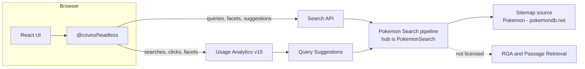

# Pokédex Search

A Coveo Headless search experience over the national Pokédex pages on [pokemondb.net](https://pokemondb.net). The index is the Coveo trial organization `voljzmfhemcvoorg`. The interface is a Vite + React 19 app using `@coveo/headless` 3.4.1.

**Live demo:** https://midya8.github.io/coveo-pokemon-challenge/

## Demo

The panel path is a conjunctive type filter, then a name search that survives a cold Query Suggestions model.

1. Open the deployed app, or run it locally with `VITE_COVEO_API_KEY` set.
2. In **Type**, select **Fire** and **Flying**. The facet says “Match all selected types.”
3. The result set is the six Fire/Flying Pokémon. **Charizard** is on that page. Open it.
4. **Back to search** restores the same filters. The query, facets, and page live in the URL hash.
5. Search `charizard`, or a phrase the Query Suggestions model has not learned (for example `xyznotapokemon`). Learned queries show ML suggestions. An empty suggestion list falls back to instant results from the index instead of a blank dropdown.
6. **Ability** and **Generation** are ordinary disjunctive facets. **Sort** can order by relevance, Pokédex number, name, or base stat total.

The timed version, with a fallback for each failure, is [docs/DEMO_SCRIPT.md](docs/DEMO_SCRIPT.md).

Passage Retrieval is not licensed on this trial. The results column says so, in a note, after a single probe. It does not raise a search error. Relevance Generative Answering renders only when the pipeline returns an answer. On this org it stays hidden.

## Architecture

How the pieces fit, and why the non-obvious choices were made, is written up in [docs/ARCHITECTURE.md](docs/ARCHITECTURE.md) and [docs/DECISIONS.md](docs/DECISIONS.md).



| Path | Role |
|---|---|
| [`app/`](app/) | Search UI. Headless owns query state, analytics, and the Search API. React owns markup and routing. |
| [`coveo-config/`](coveo-config/) | Source settings, web-scraping config, field definitions, and the query-pipeline statements. The field-by-field catalog is [docs/FIELDS.md](docs/FIELDS.md). |
| [`tools/`](tools/) | Scraping validator, org setup, analytics seeding, pipeline apply, and an index check for the Fire + Flying demo. |

Headless rather than Atomic: the result card (artwork, types, stats), the generation facet in natural order (`Generation 1` … `Generation 10`), and the `/pokemon/:slug` detail route are all custom. Atomic would have meant fighting its result template and router. The engine uses `getOrganizationEndpoints` so search and analytics follow the org’s regional endpoints. `@coveo/headless` is one prebuilt bundle, so it stays on the first load. The detail route is loaded only when a card is opened.

## Setup

```bash
cd app
cp .env.example .env          # then set VITE_COVEO_API_KEY
npm install
npm run dev
```

Without a search token the UI still boots, against Coveo’s public sample organization. Pokémon fields, the type facet, and the detail page need the trial org.

```bash
npm run lint
npm test
npm run build
npm run e2e             # Playwright: Fire + Flying shows Charizard, and an empty suggestion list falls back
```

GitHub Actions runs those three, plus `python -m unittest tools/test_pipeline_plan.py`. No Coveo credentials are required in CI.

The scraping config can be checked locally before it is pasted into a source:

```bash
python3 -m venv tools/.venv && tools/.venv/bin/pip install -r tools/requirements.txt
tools/.venv/bin/python -I tools/validate_scraping.py --sitemap bulbasaur charizard
```

GitHub Pages is still `app/scripts/deploy.sh`. It builds with `--base="/<repo>/"`, copies `index.html` to `404.html` so `/pokemon/<slug>` deep links load, and pushes the `gh-pages` branch. Inject `VITE_COVEO_ORG_ID` and `VITE_COVEO_API_KEY` in the environment before running it. A build without them publishes the sample-org fallback.

## Environment

| Variable | Where | Purpose |
|---|---|---|
| `VITE_COVEO_ORG_ID` | `app/.env` | Trial org. Defaults to `voljzmfhemcvoorg`. Not a secret. |
| `VITE_COVEO_API_KEY` | `app/.env` | Anonymous **search** token (Execute Queries). Vite inlines it into the browser bundle. |
| `VITE_COVEO_SEARCH_HUB` | `app/.env` | Defaults to `PokemonSearch`, which is the condition on the Pokemon Search pipeline. |
| `VITE_COVEO_PIPELINE` | `app/.env` | Leave empty. The hub condition chooses the pipeline. Set it only to override that. |
| `COVEO_ADMIN_API_KEY` | shell only | Platform admin token for `tools/coveo_setup.py` and `tools/apply_pipeline.py`. Never prefix it with `VITE_`. |
| `COVEO_ORG_ID` | shell only | Optional override for the Python tools. |

Do not commit `.env`. `app/.env.example` lists the names and nothing else.

## Why the Type facet is conjunctive

Coveo facets default to `resultsMustMatch: "atLeastOneValue"`. Two selected values become a disjunction, `@pokemon_type==(Fire,Flying)`, which is every Fire Pokémon plus every Flying Pokémon: 185 results, and Charizard is not on page 1.

`pokemon_type` is a multi-value facet field. The Type facet sets `resultsMustMatch: "allValues"`. The Search API then sends `@pokemon_type==Fire @pokemon_type==Flying`, and the six Pokémon that are both types come back, Charizard included. Generation and Ability stay disjunctions: a Pokémon has one generation, and “any of these abilities” is the useful reading.

An advanced query (`aq`) would have filtered the results but fought the facet controller, the URL manager, and facet analytics. The Headless option keeps all three.

Facet counts on the Type facet stay the counts for that facet ignoring its own selection, which is how Coveo lets you keep browsing values. The result summary is the conjunction. The hint under the facet title says so.

## Query suggestions, analytics, and the unlicensed APIs

Usage analytics uses Headless **legacy** mode (Usage Analytics v15). The Query Suggestions model and `tools/seed_analytics.py` learn from that protocol, and the search hub is origin level 1 on every search, click, and facet event. A made-up `trackingId` is not sent: that field belongs to the newer Event Protocol, which would ignore the events this model was trained on. Result clicks go through `buildInteractiveResult` / `buildInteractiveInstantResult`.

The suggestion model already completes popular queries (`charizard`, `fire type`, …). Phrases it has never seen return an empty list. The search box then calls `buildInstantResults` and labels the rows as index matches. Field suggestions were not used for names: `pokemon_name` is sortable, not a facet field, and the values API rejects it with `INVALID_FACET_FIELD`. Promoting it to a facet would take an admin change and a reindex. The type facet is the place to pick Fire and Flying.

`buildGeneratedAnswer` stays mounted. If the controller reports an error, the panel renders nothing rather than the error. `PassageRetrieval` calls `/rest/search/v3/passages/retrieve` once. This org answers `403 UNAUTHORIZED_ACCESS_TO_FEATURE`. The UI shows that as a note and does not call the API again on later searches.

## Index and pipeline as code

The index is a **sitemap source**, not a push source. pokemondb’s `robots.txt` sets `Crawl-delay: 2`, and the source request interval is 2,000 ms. Re-crawling from this repo would not be more reproducible than the source that is already built, and a Push API copy would drift from the site. `coveo-config/README.md` records the sitemap URL, the inclusion regex (1,028 Pokédex pages), the scraping config, and the 17 `pokemon_*` fields. `tools/coveo_setup.py` creates fields and metadata mappings. It only adds missing fields and mappings.

```bash
# Needs the anonymous search key. Prints titles, never the key.
VITE_COVEO_API_KEY=... python tools/verify_index.py
```

That check fails unless Charizard is on page 1 of Fire AND Flying.

Query pipeline rules live in [`coveo-config/pipeline.json`](coveo-config/pipeline.json):

- a filter for the production source
- thesaurus aliases (`fire lizard` ↔ `charizard`, `electric mouse` ↔ `pikachu`, `legendary` expanded to a few legendaries)
- a featured result for Charizard when the query contains “fire lizard”
- a ranking expression that boosts base stat total above 500 when the query contains “strong”

```bash
python tools/apply_pipeline.py                  # prints the statements, writes nothing
COVEO_ADMIN_API_KEY=... python tools/apply_pipeline.py            # dry run against the org
COVEO_ADMIN_API_KEY=... python tools/apply_pipeline.py --apply    # validate, then create or update
```

The apply script only touches statements whose description starts with `pokemon-challenge:`. It never deletes. Each write is validated with the statements API first. The app still sends `cq` `@source=="Pokemon - pokemondb.net"` so the test source stays hidden even before the pipeline filter is applied. The rules above are **not** applied until that command is run with an admin key.

## Known limits

- Query Suggestions return nothing for phrases the model has not learned. Instant results cover that gap. They are not a substitute for a finished model.
- Relevance Generative Answering is not licensed, and there is no answer configuration on the pipeline.
- Passage Retrieval returns 403. The note in the UI is that response, not a hidden feature flag.
- A few unreleased Pokémon have no national dex number. Those cards omit the number instead of showing `#0000`.
- The trial org is the whole backend. There is no local index.

## Next steps

- Apply `coveo-config/pipeline.json` with an admin key, then search `fire lizard` and `strong dragon` to show the thesaurus, the featured result, and the ranking expression.
- If the license changes, the generated-answer panel and the passage list already render successful payloads. No UI rewrite is required.
- Make `pokemon_name` a facet only if name completion must come from field suggestions rather than instant results.
- Once the pipeline filter is applied, the app-side `cq` can stay as a second lock or be removed. Leaving it is harmless.
