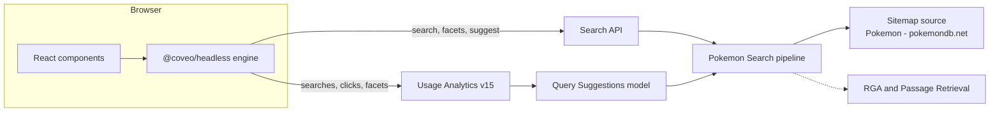

# Architecture

The search UI is a Vite + React 19 app. `@coveo/headless` 3.4.1 owns query state, the Search API, facet requests, suggestions, and usage analytics. React owns markup, routing, and the URL hash.

## Request path

The engine is created once in `app/src/coveo/engine.ts` and shared by the search page. The detail page builds a second engine so its `@uri` query does not wipe the search the user will return to.

`searchHub` is `PokemonSearch`. The pipeline condition is that hub, so the app does not send a pipeline name unless `VITE_COVEO_PIPELINE` is set. Endpoints come from `getOrganizationEndpoints`. A constant query, `@source=="Pokemon - pokemondb.net"`, hides the single-page test source. The same filter is also declared in `coveo-config/pipeline.json` for when that file is applied.

## UI map

| Piece | Headless controller | Notes |
|---|---|---|
| Search box | `buildSearchBox` | Id `pokedex-search`, shared with instant results. |
| Empty suggestions | `buildInstantResults` | Used only when the ML list is empty and the text is at least two characters. See `typeaheadMode`. |
| Type, Generation, Ability | `buildFacet` | Type uses `resultsMustMatch: "allValues"`. The others use `atLeastOneValue`. |
| Active filters | `buildBreadcrumbManager` | |
| Sort | `buildSort` | Relevance, Pokédex number, name, stat total. |
| Pager | `buildPager` | |
| Did you mean | `buildDidYouMean` | Legacy index corrections. The user applies them. |
| Results and clicks | `buildResultList`, `buildInteractiveResult` | |
| URL | `buildUrlManager` | Fragment is the hash. Back from a detail page restores it. |
| Generated answer | `buildGeneratedAnswer` | Renders nothing on error. |
| Passages | none in Headless | One `fetch` to `/rest/search/v3/passages/retrieve`. A 403 becomes a note. |

## Index

The source is a sitemap crawl of pokemondb, not a Push API load. `robots.txt` asks for a 2 second crawl delay, and the source uses a 2,000 ms interval. Coverage is the 1,028 species pages matched by the inclusion regex in `coveo-config/README.md`. Seventeen `pokemon_*` fields are mapped from scraping metadata of the same name. The field list is `coveo-config/fields.json`.

## What is not in the running app

`tools/apply_pipeline.py` can create thesaurus, featured-result, ranking, and filter statements. It is dry-run by default, only touches descriptions that start with `pokemon-challenge:`, and has no delete path. Until it is applied with an admin key, aliases such as `fire lizard` do not change ranking.

The anonymous search token is a `VITE_` variable because the browser has to send it. It is not in source. `COVEO_ADMIN_API_KEY` is read only by the Python tools and must not be prefixed with `VITE_`.
